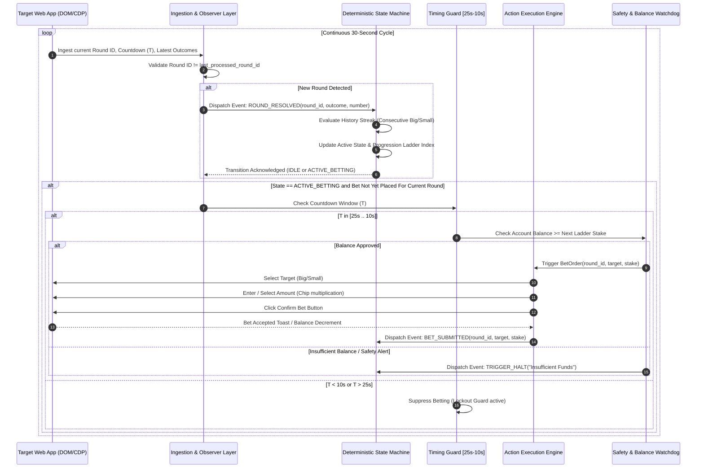
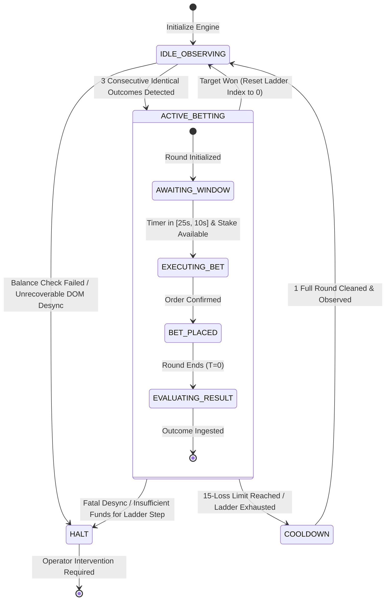

# 9X-AI: Deterministic Event-Driven Browser Automation Bot
## System Specification Document (`PROJECT_SPEC.md`)

- **Author:** SK Ariyan Ali
- **Target Runtime:** Python 3.10+ | Asyncio | Playwright (Async API) | Playwright-Stealth
- **Status:** Architectural Draft / Approved Specification
- **Revision:** 1.0.0

---

## 1. System Architecture & Asynchronous Data Flow

The 9X-AI automation bot is an event-driven, deterministic betting engine designed to interface with a fast-paced (30-second cycle) live prediction web application. The core philosophy separates **pure domain logic** (deterministic state machine, ladder progressions, safety circuit breakers) from **impure I/O mechanisms** (browser drivers, DOM observers, network listeners, input dispatchers).

### 1.1 Architecture Block Diagram

```
+----------------------------------------------------------------------------------------------------+
|                                         HOST PROCESS (Python 3.10+)                                |
|                                                                                                    |
|  +--------------------------------+                  +------------------------------------------+  |
|  |     Configuration & Safety     |                  |           Application Entrypoint         |  |
|  |  - settings.py                 |                  |           - main.py                      |  |
|  |  - selectors.json              |                  |           - Signal Handlers (SIGINT)     |  |
|  |  - circuit_breaker.py          |                  |           - Graceful Shutdown            |  |
|  +----------------+---------------+                  +--------------------+---------------------+  |
|                   |                                                       |                        |
|                   v                                                       v                        |
|  +------------------------------------------------------------------------+---------------------+  |
|  |                                ASYNC RUNTIME ORCHESTRATOR (runner.py)                        |  |
|  +--------------------+---------------------------------------------------+---------------------+  |
|                       |                                                   ^                        |
|         Event Payload | (Round ID, Timer, History)         Execution Plan | (Target, Stake, Round) |
|                       v                                                   |                        |
|  +--------------------+---------------+                  +----------------+---------------------+  |
|  |      DOM & NETWORK INGESTION       |                  |        DETERMINISTIC STATE ENGINE    |  |
|  |  - observer.py                     |                  |  - state_machine.py                  |  |
|  |  - Round ID Deduping               |                  |  - Pure functions & transitions      |  |
|  |  - Timer Clock Synchronization     |                  |  - Fixed 16-Step Bet Ladder          |  |
|  |  - Outcome History Extraction      |                  |  - Target Selection (Streak Counter) |  |
|  +--------------------+---------------+                  +--------------------------------------+  |
|                       ^                                                   |                        |
|          DOM Mutation | CDP Intercept                      Execute Action | Confirmed Submission   |
|                       |                                                   v                        |
|  +--------------------+---------------------------------------------------+---------------------+  |
|  |                            BROWSER AUTOMATION SUBSYSTEM (Playwright)                         |  |
|  |  - context.py: launch_persistent_context (User Profile, Cookies, LocalStorage)               |  |
|  |  - executor.py: Humanized Input Dispatcher, Timing Gatekeeper [T-25s .. T-10s]              |  |
|  |  - playwright-stealth: Anti-Bot & Fingerprint Evasion (WebRTC, Canvas, CDP evasion)         |  |
|  +--------------------+---------------------------------------------------+---------------------+  |
+-----------------------|---------------------------------------------------|------------------------+
                        |                                                   |
                        v                                                   v
+----------------------------------------------------------------------------------------------------+
|                                    TARGET WEB APPLICATION (Chromium)                               |
|                                                                                                    |
|  - Live Countdown Timer [30s -> 0s]                  - Order Confirmation Dialog / Toast           |
|  - Round Number Header / ID                          - Outcome Table (0-9 Number -> Small / Big)   |
|  - Target Selectors (Small: 0-4, Big: 5-9)           - User Wallet Balance Feed                    |
+----------------------------------------------------------------------------------------------------+
```

### 1.2 Asynchronous End-to-End Data Flow



### 1.3 Key Architectural Guardrails
1. **Idempotency via Round ID Tracking:**
   - The engine maintains `last_processed_round_id` and `last_bet_round_id`.
   - Under no circumstances can two bets be placed on the same Round ID.
   - If a DOM re-render causes duplicate triggers within the same cycle, the transaction is rejected at the state machine boundary before reaching the executor.
2. **Strict Timing Guard [T-25s to T-10s]:**
   - Game rounds are 30 seconds.
   - Execution is restricted strictly between second 25 and second 10.
   - If the bot detects a streak at `T <= 9s`, the round is bypassed; the bot waits for the next round resolution to prevent lockout failures and network race conditions.
3. **Session Persistence via `launch_persistent_context`:**
   - Chrome user data directory (`user_data/`) stores session cookies, token headers, and local storage.
   - Allows a one-time manual authentication flow by the human operator, followed by seamless automated restarts without re-login credential scraping.

---

## 2. State Machine Specifications

The bot's betting decision logic is governed by a **Deterministic Finite State Machine (FSM)**. Decision-making is decoupled from asynchronous I/O and implemented as pure state transitions.



### 2.1 State Definitions

| State Name | Responsibilities | Permitted Actions | Exit Triggers |
| :--- | :--- | :--- | :--- |
| `IDLE_OBSERVING` | Monitors round completions. Ingests numbers/outcomes. Computes running streak lengths. | Read-only DOM inspection. No bets placed. | - Streak count reaches 3 (`ACTIVE_BETTING`)<br>- Safety circuit tripped (`HALT`) |
| `ACTIVE_BETTING` | Executes fixed ladder progression against the fixed opposite target. Manages ladder step transitions. | Place bets within [25s, 10s] window. Update ladder index. | - Target outcome hits (`IDLE_OBSERVING`)<br>- Ladder exhausted at Step 15 (`COOLDOWN`)<br>- Safety threshold hit (`HALT`) |
| `COOLDOWN` | Safety buffer state entered after aborting an exhausted cycle. Prevents re-triggering on stale streak data. | Clears internal cycle context. Observes 1 clean resolution without acting. | - Next round resolution parsed cleanly (`IDLE_OBSERVING`) |
| `HALT` | Emergency fail-safe state. Engine halts all background tasks, issues alerts, and preserves logs. | No betting. No automated recovery. | - Manual operator restart or CLI reset command. |

### 2.2 Formal State Transition Table

| Current State | Event / Input | Guard Condition | Next State | Actions & Side Effects |
| :--- | :--- | :--- | :--- | :--- |
| `IDLE_OBSERVING` | `ROUND_RESOLVED` | `streak_length >= 3` | `ACTIVE_BETTING` | - Set `target_outcome = OPPOSTE(streak_type)`<br>- Set `ladder_index = 0`<br>- Set `streak_origin = streak_type` |
| `IDLE_OBSERVING` | `ROUND_RESOLVED` | `streak_length < 3` | `IDLE_OBSERVING` | - Append outcome to history buffer<br>- Recalculate streak counter |
| `ACTIVE_BETTING` | `ROUND_RESOLVED` | `outcome == target_outcome` (WIN) | `IDLE_OBSERVING` | - Log Win Metrics & Net Profit<br>- Reset `ladder_index = 0`<br>- Clear `target_outcome`<br>- Clear active cycle context |
| `ACTIVE_BETTING` | `ROUND_RESOLVED` | `outcome != target_outcome` AND `ladder_index < 15` (LOSS) | `ACTIVE_BETTING` | - Increment `ladder_index += 1`<br>- Log Loss & Next Projected Stake<br>- Maintain original `target_outcome` |
| `ACTIVE_BETTING` | `ROUND_RESOLVED` | `outcome != target_outcome` AND `ladder_index >= 15` (LOSS LIMIT EXHAUSTED) | `COOLDOWN` | - **Abort Cycle Immediately**<br>- Reset `ladder_index = 0`<br>- Clear `target_outcome`<br>- Log Max Loss Drawdown Alert |
| `ACTIVE_BETTING` | `BALANCE_LOW` | `wallet_balance < next_bet_amount` | `HALT` | - Emit CRITICAL error log<br>- Send operator notification<br>- Disable all betting loops |
| `COOLDOWN` | `ROUND_RESOLVED` | `round_id > cooldown_round_id` | `IDLE_OBSERVING` | - Reset streak counter based on new fresh state<br>- Resume passive observation |
| `* (ANY)` | `DOM_DESYNC` | `consecutive_desync_errors >= 3` | `HALT` | - Take diagnostic screenshot<br>- Dump DOM snapshot to disk<br>- Abort process cleanly |

### 2.3 The 16-Step Bet Progression Ladder

The bot implements an immutable 16-step martingale-style risk ladder. If an initial bet loses, the bot persists with the original target while advancing along the ladder:

$$\text{Ladder} = [1, 3, 7, 15, 30, 35, 75, 150, 350, 750, 1500, 3500, 7000, 15000, 35000, 75000]$$

| Step Index | Bet Amount (Units) | Cumulative Capital At Risk | Payout on Win (2x) | Net Profit on Win at Step |
| :---: | :---: | :---: | :---: | :---: |
| **0** | **1** | 1 | 2 | +1 |
| **1** | **3** | 4 | 6 | +2 |
| **2** | **7** | 11 | 14 | +3 |
| **3** | **15** | 26 | 30 | +4 |
| **4** | **30** | 56 | 60 | +4 |
| **5** | **35** | 91 | 70 | -21 *(Recovery Mitigation)* |
| **6** | **75** | 166 | 150 | -16 *(Recovery Mitigation)* |
| **7** | **150** | 316 | 300 | -16 *(Recovery Mitigation)* |
| **8** | **350** | 666 | 700 | +34 |
| **9** | **750** | 1,416 | 1,500 | +84 |
| **10** | **1,500** | 2,916 | 3,000 | +84 |
| **11** | **3,500** | 6,416 | 7,000 | +584 |
| **12** | **7,000** | 13,416 | 14,000 | +584 |
| **13** | **15,000** | 28,416 | 30,000 | +1,584 |
| **14** | **35,000** | 63,416 | 70,000 | +6,584 |
| **15** | **75,000** | **138,416** | 150,000 | **+11,584** |

> [!IMPORTANT]
> **Loss Limit Rule:** Step Index 15 represents the 16th and final step. If the bet at Step 15 loses (16 total consecutive losses in the cycle), the engine triggers the **Hard Cycle Abort**. The ladder index resets to 0, total capital loss of 138,416 is registered to the audit log, and the bot drops to `COOLDOWN` before returning to `IDLE_OBSERVING`.

---

## 3. Project File Structure

The project is structured with modularity, clean separation of concerns, and rigorous testability at its core.

```
d:\9X-AI\
├── .env.example                     # Environment template (HEADLESS, TIMEOUT, BASE_URL)
├── .gitignore                       # Git ignore (user_data/, logs/, .env, pytest_cache)
├── requirements.txt                 # Pinned dependencies
├── README.md                        # Quickstart and operations manual
├── PROJECT_SPEC.md                  # This definitive system specification document
│
├── config/
│   ├── __init__.py
│   ├── settings.py                  # Pydantic v2 BaseSettings (timing limits, ladder, paths)
│   └── selectors.py                 # Dataclasses & schema for abstracted UI selectors
│
├── core/
│   ├── __init__.py
│   ├── models.py                    # Enum & Data models (GameOutcome, RoundData, BetOrder)
│   ├── ladder.py                    # Progression Ladder manager and stake calculators
│   └── state_machine.py             # Pure, deterministic state engine (zero browser dependencies)
│
├── browser/
│   ├── __init__.py
│   ├── context.py                   # Persistent context factory, stealth injection, anti-fingerprint
│   ├── observer.py                  # DOM polling, MutationObserver & Network response interceptors
│   └── executor.py                  # Humanized mouse/keyboard click dispatch, timing gatekeeper
│
├── engine/
│   ├── __init__.py
│   └── runner.py                    # Asynchronous orchestration loop coupling observer, FSM & executor
│
├── utils/
│   ├── __init__.py
│   ├── logger.py                    # Loguru structured JSON/console logging with round tracing
│   └── circuit_breaker.py           # Balance thresholds, consecutive error counters, watchdog
│
├── tests/
│   ├── __init__.py
│   ├── conftest.py                  # Pytest fixtures and mock round generator
│   ├── test_state_machine.py        # 100% coverage unit tests for state machine transitions
│   ├── test_ladder.py               # Ladder step boundary, win reset, and exhaustion tests
│   └── test_timing_window.py        # Verification of [25s .. 10s] lockout guard logic
│
├── user_data/                       # Persistent Chromium context directory (gitignored)
│   └── Default/                     # Storage for cookies, localStorage, session tokens
│
└── main.py                          # CLI entrypoint with signal handlers (SIGINT/SIGTERM)
```

---

## 4. Selector Configuration Schema

To ensure resilience against target UI updates, all DOM selectors are abstracted out of business logic into a structured configuration schema. 

### 4.1 Schema Definition (`config/selectors.py`)

```python
from dataclasses import dataclass, field
from typing import List, Optional

@dataclass(frozen=True)
class SelectorTarget:
    """Defines a selector with primary and resilient fallback strategies."""
    css: str
    xpath: Optional[str] = None
    description: str = ""

@dataclass(frozen=True)
class AppSelectors:
    # Round Identification
    current_round_id: SelectorTarget
    
    # Timing & Countdown
    countdown_timer_seconds: SelectorTarget
    
    # Game History & Results
    history_table_rows: SelectorTarget
    history_row_round_id: SelectorTarget
    history_row_result_number: SelectorTarget
    history_row_result_outcome: SelectorTarget  # "Big" / "Small" indicator
    
    # Interactive Betting Controls
    bet_button_big: SelectorTarget
    bet_button_small: SelectorTarget
    
    # Amount Input & Chip Multipliers
    amount_input_field: Optional[SelectorTarget] = None
    chip_multiplier_1: Optional[SelectorTarget] = None
    chip_multiplier_5: Optional[SelectorTarget] = None
    chip_multiplier_10: Optional[SelectorTarget] = None
    chip_multiplier_100: Optional[SelectorTarget] = None
    
    # Order Confirmation
    confirm_bet_button: SelectorTarget
    cancel_bet_button: Optional[SelectorTarget] = None
    
    # Feedback & Account Status
    wallet_balance_display: SelectorTarget
    bet_success_toast: SelectorTarget
    bet_error_toast: SelectorTarget
```

### 4.2 Standard Selector Configuration Template (`config/selectors.json`)

```json
{
  "current_round_id": {
    "css": "div[class*='period-number'], span.issue-num, [data-testid='round-id']",
    "xpath": "//div[contains(@class, 'period') or contains(@class, 'issue')]",
    "description": "Unique round identifier for the active cycle"
  },
  "countdown_timer_seconds": {
    "css": "div.countdown-sec, div[class*='timer'] span:last-child, .clock-seconds",
    "xpath": "//div[contains(@class, 'countdown') or contains(@class, 'timer')]//span[last()]",
    "description": "Countdown timer displaying seconds remaining (00 to 30)"
  },
  "history_table_rows": {
    "css": "table.history-table tbody tr, div.game-history-list > div.row",
    "xpath": "//table[contains(@class, 'history')]//tr[td]",
    "description": "List of finished round result rows"
  },
  "history_row_round_id": {
    "css": "td.col-issue, .row-issue",
    "xpath": ".//td[1]",
    "description": "Round ID column within a history row"
  },
  "history_row_result_number": {
    "css": "td.col-number span, .result-number-ball",
    "xpath": ".//td[2]//span",
    "description": "Result number (0-9)"
  },
  "history_row_result_outcome": {
    "css": "td.col-size span, .tag-big, .tag-small",
    "xpath": ".//td[contains(@class, 'size') or contains(@class, 'type')]",
    "description": "Label indicating 'Big' or 'Small'"
  },
  "bet_button_big": {
    "css": "button.btn-big, div[data-value='big'], .bet-option-big",
    "xpath": "//button[contains(text(), 'Big') or @data-type='big']",
    "description": "Selection button for Big outcome"
  },
  "bet_button_small": {
    "css": "button.btn-small, div[data-value='small'], .bet-option-small",
    "xpath": "//button[contains(text(), 'Small') or @data-type='small']",
    "description": "Selection button for Small outcome"
  },
  "amount_input_field": {
    "css": "input.bet-amount-input, input[type='number'].amount",
    "xpath": "//input[contains(@class, 'amount') or @placeholder='Amount']",
    "description": "Input field to enter custom bet stake"
  },
  "confirm_bet_button": {
    "css": "button.btn-confirm-bet, button[class*='submit-bet'], .bet-confirm",
    "xpath": "//button[contains(text(), 'Confirm') or contains(text(), 'Bet')]",
    "description": "Submission button to commit bet order"
  },
  "wallet_balance_display": {
    "css": "span.balance-amount, div.user-balance, .wallet-num",
    "xpath": "//span[contains(@class, 'balance')]",
    "description": "Real-time user account balance for risk validation"
  },
  "bet_success_toast": {
    "css": "div.toast-success, div.van-toast--success, div[role='alert'].success",
    "xpath": "//div[contains(@class, 'toast') and contains(@class, 'success')]",
    "description": "Notification element indicating successful bet placement"
  },
  "bet_error_toast": {
    "css": "div.toast-fail, div.van-toast--fail, div[role='alert'].error",
    "xpath": "//div[contains(@class, 'toast') and (contains(@class, 'fail') or contains(@class, 'error'))]",
    "description": "Notification element indicating rejected bet"
  }
}
```

---

## 5. Phased Implementation Checklist

This checklist defines the rigorous roadmap for implementing the bot. Each milestone has strictly verified acceptance criteria.

### Phase 1: Core Domain Logic & State Machine (Zero-I/O Layer)
- [ ] **1.1 Data Models (`core/models.py`):**
  - Implement `GameOutcome` Enum (`BIG`, `SMALL`).
  - Implement `NumberMapping` logic ($0..4 \to \text{SMALL}, 5..9 \to \text{BIG}$).
  - Implement `RoundData`, `BetOrder`, `BetResolution`, and `EngineState` dataclasses.
- [ ] **1.2 Fixed Ladder Progression Engine (`core/ladder.py`):**
  - Implement 16-step array `[1, 3, 7, 15, 30, 35, 75, 150, 350, 750, 1500, 3500, 7000, 15000, 35000, 75000]`.
  - Provide `get_stake(index: int) -> int`.
  - Provide `is_exhausted(index: int) -> bool` (checks index == 15).
  - Provide cumulative risk calculation.
- [ ] **1.3 Deterministic State Machine (`core/state_machine.py`):**
  - Implement `StateMachine` class with strict state tracking (`IDLE_OBSERVING`, `ACTIVE_BETTING`, `COOLDOWN`, `HALT`).
  - Implement streak detection logic ($N=3$ identical consecutive outcomes trigger betting on opposite).
  - Implement win resolution (resets ladder to 0, returns to `IDLE_OBSERVING`).
  - Implement loss resolution (increments ladder index, preserves target).
  - Implement 15-loss exhaustion limit (resets ladder to 0, routes to `COOLDOWN`).
- [ ] **1.4 Unit Test Suite (`tests/test_state_machine.py`, `tests/test_ladder.py`):**
  - Verify 3-streak triggers on both Big and Small.
  - Verify alternating outcomes (`Big`, `Small`, `Big`) do not trigger active state.
  - Verify full 16-step loss sequence aborts to `COOLDOWN` without exceeding index 15.
  - Verify win at step $K \in [0..15]$ resets ladder to 0 and returns to `IDLE_OBSERVING`.
  - **Acceptance Criteria:** 100% test pass rate with `pytest tests/`.

---

### Phase 2: Browser Context & Stealth Infrastructure
- [ ] **2.1 Configuration Subsystem (`config/settings.py`):**
  - Implement Pydantic settings loading `.env` variables (`BASE_URL`, `HEADLESS`, `USER_DATA_DIR`, `MIN_TIMING_SEC`, `MAX_TIMING_SEC`, `STOP_LOSS_BALANCE`).
- [ ] **2.2 Persistent Context Setup (`browser/context.py`):**
  - Implement `create_persistent_browser_context(user_data_dir: Path)` using `playwright.async_api.launch_persistent_context`.
  - Configure viewport, user agent, locale, permissions, and timezone.
- [ ] **2.3 Anti-Detection & Evasion:**
  - Integrate `playwright-stealth` across all context pages.
  - Mask navigator automation flags (`navigator.webdriver`, fake WebGL vendor, realistic audio context).
- [ ] **2.4 Interactive Operator Authentication Flow:**
  - Create CLI sub-command (`python main.py --login`) to launch visible browser, allow manual login, capture auth cookies, and save them in `user_data/`.
  - **Acceptance Criteria:** Browser loads saved session without requiring login credentials; passes basic bot detection tests (e.g., bot.sannysoft.com).

---

### Phase 3: DOM Observation & Ingestion Pipeline
- [ ] **3.1 Selector Registry (`config/selectors.py`):**
  - Load and validate JSON selector mapping with fallback priority.
- [ ] **3.2 Ingestion Engine (`browser/observer.py`):**
  - Implement asynchronous DOM scraper for:
    - Current Active `Round ID`.
    - Remaining Countdown Seconds ($T \in [0..30]$).
    - Result History List (minimum last 10 rounds).
  - Implement stale data guard: Prevent round processing if `round_id <= last_processed_round_id`.
  - Implement network listener fallback: Intercept WebSocket/HTTP API responses for round results if available.
- [ ] **3.3 Clock Drift & Desync Monitor:**
  - Detect clock freezes or stuck timers.
  - Trigger warning if countdown skips or DOM fails to update after 35 seconds.
  - **Acceptance Criteria:** Real-time log output accurately mirrors web app countdown and history without dropping or duplicating rounds over a 10-round live observation period.

---

### Phase 4: Order Execution Engine & Timing Safeguards
- [ ] **4.1 Timing Window Gatekeeper (`browser/executor.py`):**
  - Implement strict assertion: $10 \le T_{\text{countdown}} \le 25$.
  - Reject order dispatch if countdown is $< 10$ seconds or $> 25$ seconds.
- [ ] **4.2 Humanized Input Automation:**
  - Implement randomized natural delays for cursor movement and clicks ($80\text{ms} - 250\text{ms}$).
  - Implement target selection click (`Big` or `Small`).
  - Implement stake input: Set amount via direct input fill or chip multiplier button combinations.
  - Implement bet confirmation click.
- [ ] **4.3 Order Confirmation Verification:**
  - Wait for UI success toast or balance deduction confirmation within 3 seconds.
  - Handle error toast detection (e.g., "Round Closed", "Network Error").
  - **Acceptance Criteria:** Successfully executes test simulated bets in browser within the $25\text{s}-10\text{s}$ window, correctly setting targets and amounts without lockout errors.

---

### Phase 5: End-to-End Orchestrator & Circuit Breakers
- [ ] **5.1 Orchestration Loop (`engine/runner.py`):**
  - Link `Observer`, `StateMachine`, and `Executor` inside an `asyncio` event loop.
  - Maintain round lifecycle: Ingest $\to$ Evaluate $\to$ Gatekeep $\to$ Execute $\to$ Ingest Outcome $\to$ Transition.
- [ ] **5.2 Safety Circuit Breaker (`utils/circuit_breaker.py`):**
  - Stop engine immediately if wallet balance drops below `MIN_BALANCE_THRESHOLD`.
  - Stop engine if 3 consecutive DOM reading errors or execution timeouts occur.
- [ ] **5.3 Structured Logging & Audit Trail (`utils/logger.py`):**
  - Log all round IDs, detected streaks, bets placed, ladder index changes, and win/loss PnL to file (`logs/audit_{date}.log`) and console.
- [ ] **5.4 CLI Interface & Signal Handling (`main.py`):**
  - Support commands: `python main.py run` (live execution), `python main.py dry-run` (paper trading), `python main.py test-selectors`.
  - Register clean SIGINT/SIGTERM handlers to release Playwright browser contexts cleanly without data corruption.
  - **Acceptance Criteria:** System runs unattended for 30 consecutive live rounds in `dry-run` mode without exceptions, maintaining 100% state accuracy.

---

### Phase 6: Operational Verification & Resilience Testing
- [ ] **6.1 Dry-Run Simulation Mode:**
  - Run engine with active DOM reading and state transitions, but mock out the final confirmation click.
  - Verify that virtual ladder positions match theoretical expectation.
- [ ] **6.2 Network Disconnect & Reconnect Testing:**
  - Simulate intermittent network drops. Verify the bot pauses and resynchronizes cleanly without placing stale bets.
- [ ] **6.3 Final Documentation & Runbook (`README.md`):**
  - Document setup steps, selector calibration instructions, and emergency recovery runbooks.
