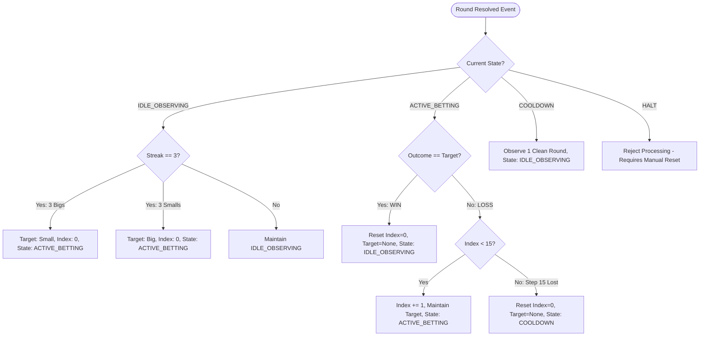
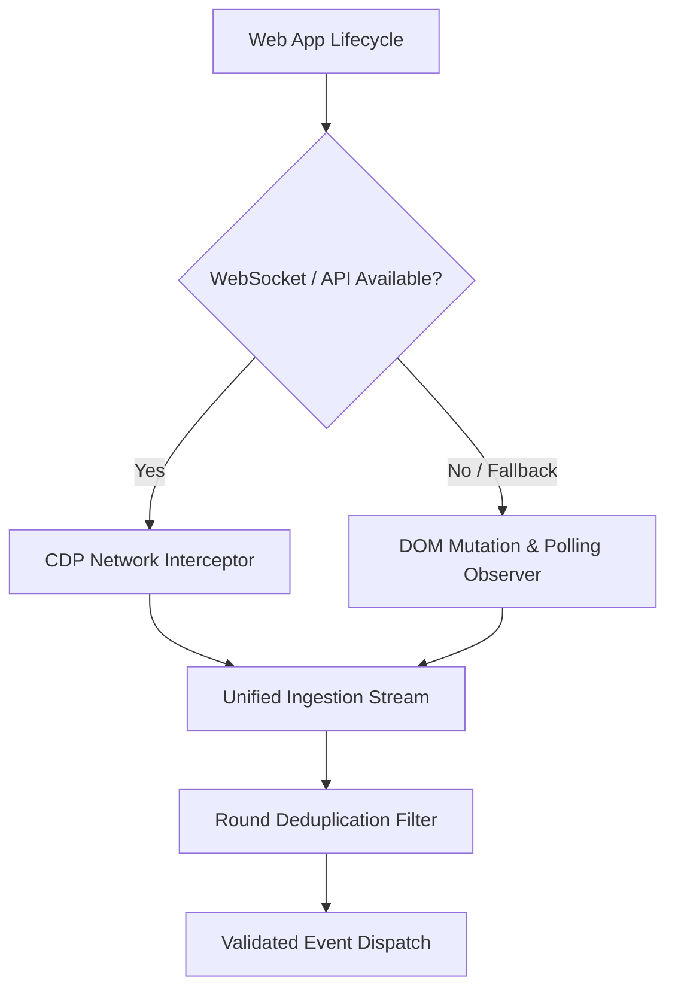

# 9X-AI: Technical Approach & Engineering Architecture
## Deterministic Browser Automation Engine

- **Author:** SK Ariyan Ali
- **Role:** Senior Systems & Automation Engineer
- **Document Version:** 1.0.0
- **Target Runtime:** Python 3.10+ | Asyncio | Playwright (Async API) | Playwright-Stealth
- **Status:** Approved Engineering Strategy

---

## 1. Executive Summary & Design Philosophy

The **9X-AI** platform is an ultra-reliable, event-driven browser automation bot designed to operate continuously against a 30-second live prediction game. The game requires real-time DOM/network ingestion, strict sub-second timing precision, and deterministic risk ladder progression.

### 1.1 Core Engineering Principles

1. **Hexagonal Architecture (Ports & Adapters):**
   The core state machine and betting algorithm are implemented as pure, zero-I/O domain logic. Playwright, the browser DOM, filesystem logging, and network streams are external adapters. This allows 100% of state transitions, streak detections, and ladder edge-cases to be unit-tested without launching a browser.
2. **Strict Determinism Over Heuristics:**
   No nondeterministic probabilistic heuristics or LLMs are used for runtime decision-making. The state engine operates as a mathematically provable Finite State Machine (FSM):
   $$\text{FSM}(S_t, E_t) \to (S_{t+1}, A_{t+1})$$
   where $S$ is state, $E$ is event, and $A$ is an atomic action.
3. **Idempotency & Zero Double-Betting Guarantee:**
   Every betting transaction is strictly bound to an immutable `RoundID`. The system guarantees that at most one bet can ever be committed per round, even under DOM flickering, multiple network events, or clock jitter.
4. **Defensive Timing & Lockout Prevention:**
   A hard gatekeeper strictly bounds execution between **second 25 and second 10** of the 30-second countdown. Execution requests outside this window are automatically suppressed to eliminate late-submission lockout penalties.

---

## 2. High-Level Architectural Decomposition

```
                           +-----------------------------------------------+
                           |                 OPERATOR CLI                  |
                           |   main.py [--login | --run | --dry-run | ...]  |
                           +-----------------------+-----------------------+
                                                   |
                                                   v
+--------------------------------------------------+--------------------------------------------------+
|                                    ASYNC ORCHESTRATION ENGINE (runner.py)                           |
|                                                                                                     |
|   +--------------------------+    +--------------------------+    +-----------------------------+   |
|   |    TIMING GATEKEEPER     |    |   CIRCUIT BREAKER WATCH  |    |     AUDIT & EVENT LOGGER    |   |
|   |  - Window: [25s .. 10s]  |    |  - Balance Threshold     |    |  - Structured JSON Logs     |   |
|   |  - Lockout Prevention    |    |  - Desync Detection      |    |  - PnL Tracking             |   |
|   +------------+-------------+    +------------+-------------+    +--------------+--------------+   |
+----------------|-------------------------------|---------------------------------|------------------+
                 |                               |                                 |
                 v                               v                                 v
+----------------+-------------------------------+---------------------------------+------------------+
|                                        PORTS & ADAPTERS INTERFACE                                    |
+------------------------------------------------+----------------------------------------------------+
                         |                                               |
                         v                                               v
+------------------------------------------------+   +------------------------------------------------+
|           PURE DOMAIN LAYER (Zero I/O)         |   |          INFRASTRUCTURE & BROWSER LAYER        |
|                                                |   |                                                |
|  1. Deterministic State Machine                |   |  1. Persistent Browser Context                 |
|     - IDLE_OBSERVING                           |   |     - launch_persistent_context                |
|     - ACTIVE_BETTING                           |   |     - User Data Dir / Cookie Preservation      |
|     - COOLDOWN                                 |   |                                                |
|     - HALT                                     |   |  2. Stealth & Evasion Layer                    |
|                                                |   |     - playwright-stealth                       |
|  2. Streak Detector                            |   |     - Navigator / WebGL / Canvas masking       |
|     - Sliding window (N=3 identical outcomes)  |   |                                                |
|                                                |   |  3. Ingestion Observer                         |
|  3. Fixed 16-Step Ladder Progression           |   |     - Hybrid DOM Polling + CDP Interception    |
|     - [1, 3, 7, 15, ..., 75000]                |   |     - Round ID & Countdown Parsing             |
|     - Loss Limit Circuit (15 losses abort)     |   |                                                |
|                                                |   |  4. Action Executor                            |
|  4. PnL & Risk Calculators                     |   |     - Humanized Clicks (Bézier trajectories)   |
|                                                |   |     - Stake Entry & Confirmation Detection     |
+------------------------------------------------+   +------------------------------------------------+
```

---

## 3. Subsystem Deep-Dive

### 3.1 Subsystem 1: Pure Domain & Deterministic State Machine (`core/`)

The core domain does not know about Playwright or WebSockets. It receives typed immutable events and outputs updated states and action directives.

#### A. Data Models & Typings (`core/models.py`)
```python
from enum import Enum
from dataclasses import dataclass
from typing import Optional

class GameOutcome(str, Enum):
    BIG = "Big"
    SMALL = "Small"

    @classmethod
    def from_number(cls, number: int) -> "GameOutcome":
        if 0 <= number <= 4:
            return cls.SMALL
        elif 5 <= number <= 9:
            return cls.BIG
        raise ValueError(f"Invalid outcome number: {number}")

    @property
    def opposite(self) -> "GameOutcome":
        return GameOutcome.SMALL if self == GameOutcome.BIG else GameOutcome.BIG

class EngineState(str, Enum):
    IDLE_OBSERVING = "IDLE_OBSERVING"
    ACTIVE_BETTING = "ACTIVE_BETTING"
    COOLDOWN = "COOLDOWN"
    HALT = "HALT"

@dataclass(frozen=True)
class RoundResolution:
    round_id: str
    result_number: int
    outcome: GameOutcome

@dataclass(frozen=True)
class BetOrder:
    round_id: str
    target: GameOutcome
    amount: int
    ladder_index: int
```

#### B. The 16-Step Ladder Progression (`core/ladder.py`)
The progression ladder is an immutable constant sequence:
```python
BET_LADDER: tuple[int, ...] = (
    1, 3, 7, 15, 30, 35, 75, 150, 
    350, 750, 1500, 3500, 7000, 15000, 35000, 75000
)
MAX_LADDER_INDEX: int = 15  # 16th and final step
```

**Ladder Lifecycle Logic:**
- **Initial Trigger:** On entering `ACTIVE_BETTING`, `ladder_index = 0`, `target = streak.opposite`.
- **On Win:** Target hit. `ladder_index = 0`. Bot emits a win event and drops to `IDLE_OBSERVING`.
- **On Loss (Step 0 to 14):** `ladder_index += 1`. Target remains fixed. Next bet will use `BET_LADDER[ladder_index]`.
- **On Loss at Step 15 (Hard Loss Limit):** If step 15 loses, the engine triggers the **Hard Cycle Abort**. `ladder_index` resets to 0, total cycle loss is written to audit logs, and the engine enters `COOLDOWN` for 1 round before resuming observation.

#### C. State Machine Engine (`core/state_machine.py`)
The state machine is evaluated on every `ROUND_RESOLVED` event:



---

### 3.2 Subsystem 2: Browser Context & Anti-Detection Architecture (`browser/context.py`)

#### A. Persistent Context Management
Standard ephemeral `browser.new_page()` loses session state on process restart. We use `launch_persistent_context`:
```python
from pathlib import Path
from playwright.async_api import async_playwright, BrowserContext
from playwright_stealth import stealth_async

async def create_persistent_context(user_data_dir: Path, headless: bool = False) -> BrowserContext:
    pw = await async_playwright().start()
    context = await pw.chromium.launch_persistent_context(
        user_data_dir=str(user_data_dir),
        headless=headless,
        viewport={"width": 1366, "height": 768},
        user_agent=(
            "Mozilla/5.0 (Windows NT 10.0; Win64; x64) "
            "AppleWebKit/537.36 (KHTML, like Gecko) "
            "Chrome/124.0.0.0 Safari/537.36"
        ),
        args=[
            "--disable-blink-features=AutomationControlled",
            "--disable-features=IsolateOrigins,site-per-process",
            "--disable-infobars",
            "--no-default-browser-check",
        ],
        ignore_default_args=["--enable-automation"],
    )
    # Apply stealth scripts to all newly created pages
    context.on("page", lambda page: stealth_async(page))
    return context
```

#### B. Anti-Fingerprinting Strategy
1. **CDP Overrides:** Masking `navigator.webdriver = false`.
2. **Hardware Fingerprint Normalization:** Suppressing automation flags in WebGL vendor strings and realistic Canvas noise generation.
3. **Session Re-use:** Operator logs in once with `--login` flag; session tokens, cookies, and indexedDB remain preserved in `user_data/`.

---

### 3.3 Subsystem 3: Ingestion & Observer Pipeline (`browser/observer.py`)

The ingestion layer extracts 3 critical variables:
1. `current_round_id` (e.g., `"20260923001"`)
2. `remaining_countdown_seconds` (e.g., `22`)
3. `latest_history` (list of completed `RoundResolution`)

#### Hybrid Ingestion Strategy: DOM Polling vs CDP Stream Interception



1. **Primary Ingestion (Network Interceptor):**
   Where applicable, Playwright's `page.on("response", handler)` intercepts backend game JSON responses. This provides zero-DOM-latency access to round numbers and resolutions.
2. **Secondary/Fallback Ingestion (DOM Scraper):**
   If network payloads are obfuscated, an asynchronous polling loop inspects the DOM using the fallback selector schema every `250ms`.
3. **Data Sanitization & Deduping:**
   - Round IDs are matched against a regex `r"^\d{8,16}$"`.
   - Countdown text is parsed: `int(re.search(r"\d+", text).group(0))`.
   - Results are committed only if `round_id > last_processed_round_id`.

---

### 3.4 Subsystem 4: Timing Gatekeeper & Action Execution (`browser/executor.py`)

#### A. The Timing Gatekeeper
```python
class TimingGatekeeper:
    MIN_SECONDS: int = 10
    MAX_SECONDS: int = 25

    @classmethod
    def is_within_window(cls, remaining_seconds: int) -> bool:
        """
        Ensures execution occurs strictly between second 25 and second 10.
        Prevents late lockout errors (seconds 9 to 0).
        """
        return cls.MIN_SECONDS <= remaining_seconds <= cls.MAX_SECONDS
```

#### B. Humanized Click Execution
Direct programmatic `element.click()` can trigger heuristic bot filters that detect instantaneous zero-duration mouse movements. 
The executor uses humanized action dispatch:
1. `mouse.move(x, y, steps=10)` with randomized jitter.
2. Micro-pause between target selection and confirm click ($80\text{ms} - 220\text{ms}$).
3. Verification of state confirmation: Inspects DOM for success toast or wallet balance deduction within $3.0\text{s}$.

```python
async def execute_bet_order(page: Page, order: BetOrder, selectors: AppSelectors) -> bool:
    # 1. Target Selection (Big vs Small)
    target_selector = (
        selectors.bet_button_big if order.target == GameOutcome.BIG 
        else selectors.bet_button_small
    )
    await human_click(page, target_selector)

    # 2. Enter Amount / Multiplier Chips
    await set_bet_amount(page, order.amount, selectors)

    # 3. Confirm Bet
    await human_click(page, selectors.confirm_bet_button)

    # 4. Confirmation Wait
    return await verify_bet_confirmation(page, selectors)
```

---

## 4. Failure Modes & Circuit Breakers (FMEA)

| Failure Scenario | Immediate Detection Mechanism | Automated Defensive Response |
| :--- | :--- | :--- |
| **Countdown Lockout ($T < 10\text{s}$)** | `TimingGatekeeper.is_within_window()` returns `False`. | Suppress order dispatch. Skip current round. Wait for next round resolution. |
| **Insufficient Wallet Balance** | Wallet balance check before order dispatch: `balance < order.amount`. | Immediately transition engine to `HALT`. Emit critical alarm. Terminate betting loop. |
| **DOM Selector Desynchronization** | Selector lookup throws `TimeoutError` or returns `None` for $> 3$ consecutive attempts. | Enter `HALT`. Capture diagnostic screenshot & full DOM snapshot to `logs/desync/`. |
| **Stale Round ID / Race Condition** | `round_id <= last_bet_round_id`. | Reject bet at State Machine boundary. Zero double-bets guaranteed. |
| **Long-Running Memory Creep** | V8 heap and browser process memory monitoring. | Perform periodic page cache cleanup without tearing down persistent context. |
| **Sudden Network Drop** | Page disconnect event / navigation timeout. | Pause execution. Enter reconnect backoff loop (5s, 10s, 20s). Resume once round synced. |

---

## 5. Verification & Testing Strategy

To achieve 100% operational confidence, testing is partitioned into 3 isolated tiers:

```
+-------------------------------------------------------------------------+
|                              TEST PYRAMID                               |
|                                                                         |
|                     [ Live Paper Trading / Dry-Run ]                    |
|                      (30 Rounds Real DOM Simulation)                    |
|                   -----------------------------------                   |
|                   [ Integration / Mock Browser Loop ]                   |
|                    (Mock Playwright Page + Selectors)                   |
|                 ---------------------------------------                 |
|                 [ Pure Unit Tests: FSM & Bet Ladder ]                   |
|                  (100% Code Coverage - Zero Browser I/O)                |
+-------------------------------------------------------------------------+
```

### 5.1 Tier 1: Pure Unit Tests (`tests/test_state_machine.py`, `tests/test_ladder.py`)
- Test 3 consecutive `BIG` triggers `SMALL`.
- Test 3 consecutive `SMALL` triggers `BIG`.
- Test alternating sequences do not trigger betting.
- Test full 16-loss sequence:
  - Validates exact stake values: `1 -> 3 -> 7 -> ... -> 75000`.
  - Verifies that losing at Step 15 transitions to `COOLDOWN` and resets index to 0.
- Test win at arbitrary step $K \in [0..15]$ resets index to 0 and returns to `IDLE_OBSERVING`.

### 5.2 Tier 2: Timing Gatekeeper Tests (`tests/test_timing_window.py`)
- Test inputs $T \in [26, 30]$ are rejected.
- Test inputs $T \in [10, 25]$ are accepted.
- Test inputs $T \in [0, 9]$ are rejected.

### 5.3 Tier 3: Dry-Run / Paper Trading Mode (`python main.py --dry-run`)
- In `--dry-run` mode, the bot connects to the live web app, tracks live round IDs and timers, runs the complete state machine, but mocks out the final confirmation click.
- Outputs virtual PnL and validates synchronization over a 30-round live observation period.

---

## 6. Execution Command Matrix

| Command | Purpose |
| :--- | :--- |
| `python main.py --login` | Launches visible browser for operator to authenticate manually once. Cookies are saved to `user_data/`. |
| `python main.py --dry-run` | Runs full live observer and state engine without placing real money bets (paper trading). |
| `python main.py --run` | Starts live automated betting engine with full safety circuit breakers. |
| `python main.py --test-selectors` | Scans current DOM and verifies all selectors in `config/selectors.json` resolve correctly. |
| `pytest tests/ -v --cov=core` | Executes isolated unit test suite for core logic with coverage reporting. |

---

## 7. Implementation Roadmap & Milestones

Following approval of this Technical Approach, implementation will proceed systematically in accordance with the checklist in `PROJECT_SPEC.md`:

```
Phase 1: Pure Core Domain (FSM, Ladder, Models, 100% Unit Tests)
   └── Phase 2: Browser Context & Stealth Setup (Persistent Profiles, Manual Login)
         └── Phase 3: DOM/Network Ingestion Engine (Round Tracking & Timer)
               └── Phase 4: Order Execution & Timing Gatekeeper ([25s..10s])
                     └── Phase 5: Orchestration Runner & Circuit Breakers
                           └── Phase 6: Dry-Run Simulation & Live Deployment
```
